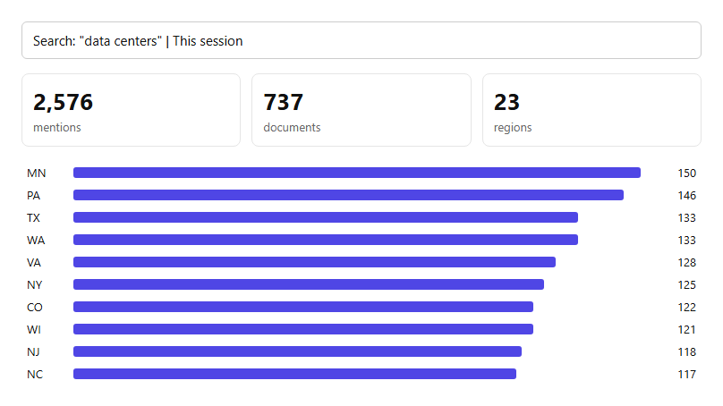

# Example: "data centers" for one prospect

_Generated by `node engine/buildExamples.js` from synthetic data. No real companies or people._

```
"data centers": 2576 mentions, 737 documents, 23 regions
Results page: out/proof/ACC-001.html
(Playwright not installed, so no PNG. npm i playwright && npx playwright install chromium)
Email draft: data centers: 2576 mentions this session
```

**Screenshot embedded in the email:**



**Email:**

Subject: data centers: 2576 mentions this session

Hi Taylor,
I ran "data centers" for Granite Payments. It came up **2576 times** across 737 documents in 23 regions this session, most in MN (150).

Happy to send the full breakdown for the regions you cover.
