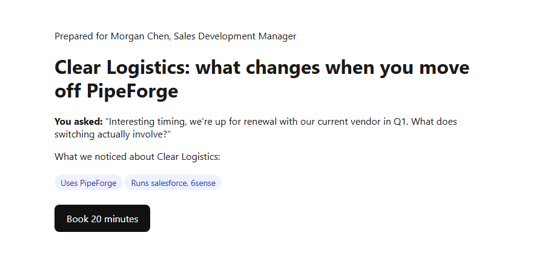

# Example: one prospect's page

_Generated by `node engine/buildExamples.js` from synthetic data. No real companies or people._

Full HTML: [example.html](example.html). Built when the prospect replied: "Interesting timing, we're up for renewal with our current vendor in Q1. What does switching actually involve?"
